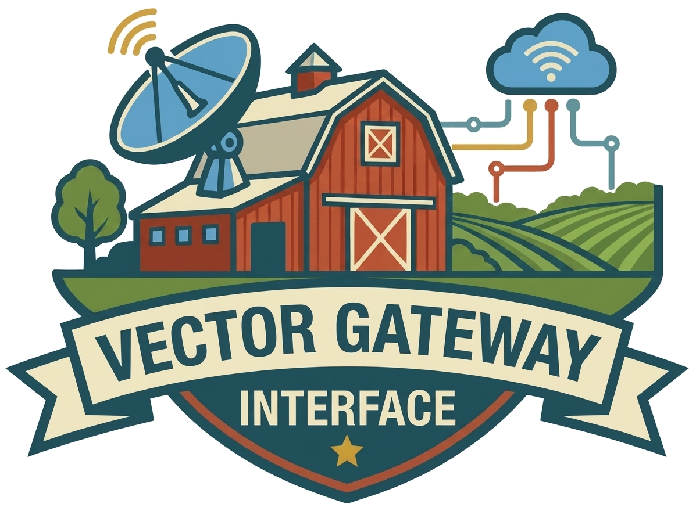

<p align="center">
  
</p>

<h1 align="center">vgi-calcite</h1>

<p align="center">
  Query VGI catalogs and table functions with Apache Calcite.<br>
  Built by <a href="https://query.farm">Query.Farm</a>.
</p>

<p align="center">
  <a href="https://github.com/Query-farm/vgi-calcite/actions/workflows/ci.yml">
    
  </a>
</p>

**vgi-calcite** connects [Apache Calcite](https://calcite.apache.org/) to
[Vector Gateway Interface (VGI)](https://github.com/Query-farm/vgi-java) workers.
Java applications can use Calcite JDBC to query a worker's catalog tables and
call its table functions with SQL.

```sql
-- Query a catalog table.
SELECT id, label FROM vgi.data.numbers WHERE id >= 4 ORDER BY id DESC;

-- Call a table function and aggregate its results.
SELECT COUNT(*), SUM(id) FROM TABLE(vgi.main.sequence(17));
```

These tables and functions are available in the included demo below.

## What you can do

- **Browse worker catalogs.** Discover tables and public table functions,
  including those in nested schemas.
- **Call table functions from SQL.** Pass literal scalar values, use named
  arguments, and omit trailing optional arguments to use the worker's defaults.
- **Use familiar SQL operations.** Filter, join, aggregate, sort, and limit
  results through Calcite.
- **Filter at the source.** Push supported predicates into compatible workers
  for catalog tables and table functions, including parameters in prepared
  `WHERE` clauses.
- **Choose a connection.** Connect over HTTP(S), TCP, or a Unix socket, or run a
  worker as a subprocess.
- **Transfer only needed columns.** Push column selection into compatible
  catalog scans and table functions, retaining columns needed by local filters
  and expressions.
- **Validate Arrow batches.** Check schemas, buffers, text, and dictionary
  indices before Calcite reads worker results.
- **Detect stale catalog metadata.** Reject changed known catalog versions
  when binding or starting a scan, with instructions to reconnect.
- **Stop stalled scans.** Use JDBC cancellation and query timeouts over HTTP,
  TCP, Unix sockets, and subprocess connections.

This adapter is **read-only**. Compatible workers receive supported filters;
Calcite rechecks the results and evaluates unsupported expressions. Joins,
aggregates, sorts, and limits run in Calcite.

This is a **pre-release connector**. Production qualification is ongoing;
see [test evidence and remaining gaps](docs/production-readiness.md). The
[Python-worker conformance checks](conformance/README.md) complement the Java
fixture tests and make the current interoperability coverage reproducible.

## Quickstart

Use **JDK 21 or 27**. The commands below are for macOS or Linux and run a
self-contained demo using the included test worker.

### 1. Build the adapter

```sh
git clone https://github.com/Query-farm/vgi-calcite.git
cd vgi-calcite
./mvnw clean verify
```

The Maven wrapper downloads the build tools and dependencies. The build runs the
tests and produces `target/vgi-calcite-0.1.0-SNAPSHOT.jar` and
`target/dependency/`. Keep the dependency directory beside the JAR when using
the packaged query runner.

### 2. Start the demo worker

In the repository directory, run:

```sh
java --add-opens=java.base/java.nio=ALL-UNNAMED \
  --enable-native-access=ALL-UNNAMED -Dio.netty.noUnsafe=false \
  -cp 'target/test-classes:target/classes:target/dependency/*' \
  farm.query.vgicalcite.FixtureWorker --http --host 127.0.0.1 --port 8000
```

Leave this terminal running. The worker serves the `demo` catalog at
`http://127.0.0.1:8000`, matching [examples/model.json](examples/model.json).

### 3. Run a SQL query

Open a second terminal in the repository directory:

```sh
java --add-opens=java.base/java.nio=ALL-UNNAMED \
  --enable-native-access=ALL-UNNAMED -Dio.netty.noUnsafe=false \
  -jar target/vgi-calcite-0.1.0-SNAPSHOT.jar examples/model.json \
  'SELECT COUNT(*) AS row_count, SUM(id) AS id_total FROM TABLE(vgi.main.sequence(17))'
```

Expected result, with columns separated by tabs:

```text
ROW_COUNT  ID_TOTAL
17         136
```

The function returns integers from 0 through 16. Try more queries from
[examples/queries.sql](examples/queries.sql), then stop the worker with
**Ctrl+C** when finished.

## Connect your own worker

Update [examples/model.json](examples/model.json) with your worker's endpoint
and catalog name:

```json
{
  "version": "1.0",
  "schemas": [
    {
      "name": "vgi",
      "type": "custom",
      "factory": "farm.query.vgicalcite.VgiSchemaFactory",
      "operand": {
        "location": "http://127.0.0.1:8000",
        "catalog": "demo"
      }
    }
  ]
}
```

`catalog` must match a catalog advertised by the worker. `name` is the local
SQL alias: a worker table named `data.numbers` becomes `vgi.data.numbers`.

For a subprocess, replace `location` with
`"command": ["/absolute/path/to/worker"]`, adding any arguments your worker
requires. Supply exactly one of `location` and `command`.

See the [usage guide](docs/usage.md) for authentication, all connection options,
and embedding in a Java application. For JDBC tools that browse tables through
metadata, use [`schemaPath`](docs/usage.md#jdbc-tools-and-schema-mounting) to
mount a worker schema directly.

## Compatibility

| Component | Version |
| --- | --- |
| Java | Tested with JDK 21 and 27 |
| Apache Calcite | 1.42.0 |
| VGI Java SDK | 0.48.0 |
| VGI RPC Java SDK | 0.33.4 |
| VGI protocol | `vgi.v3`, version 3.3.0 |

VGI v2 workers are not supported. Build dependencies are available from Maven
Central; **the adapter itself has not been published there**. To use it in
another project, [install it locally and add the Maven dependency](docs/usage.md#embed-in-a-java-application).

## Current limitations

- No writes or transactions. VGI scalar functions, aggregate functions, and
  table-in/out transforms are not exposed; Calcite's own SQL aggregates work.
- Table-function arguments must be literals. Dynamic prepared parameters
  (`?`) in table-function calls are not supported. Named calls cannot omit an
  earlier optional argument while supplying a later one.
- Predicate pushdown covers a defined subset of expressions and types; see
  [supported filters](docs/usage.md#predicate-pushdown). Worker-side join,
  aggregate, sort, and limit pushdown, distributed splits, and native-file scans
  are not implemented.
- Each scan uses an independent connection. Catalog metadata is loaded once;
  reconnect to refresh it.
- Time and timestamp values have millisecond precision.

The [usage guide](docs/usage.md#types-and-execution-limits) describes supported
types, connection behavior, and worker features that require additional adapter
support.

## Development

Run `./mvnw verify` to test real Calcite SQL queries against the included VGI
worker over HTTP, TCP, Unix sockets, and subprocess connections. No external
service is required.

See [architecture and development](docs/architecture.md) for the implementation,
test coverage, and planned extensions.

## License

[Query Farm Source-Available License, Version 1.0](LICENSE).
This is an external adapter, not an Apache Software Foundation release.
