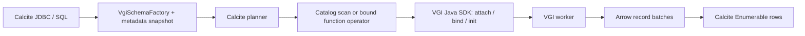

# vgi-calcite

A Java adapter that makes a **VGI worker an external data source in Apache
Calcite**. Load a JSON model, then use Calcite JDBC to query the worker's catalog
tables and table functions. No DuckDB process or Calcite fork is involved.

```sql
SELECT id, label FROM vgi.data.numbers WHERE id >= 4 ORDER BY id DESC;
SELECT COUNT(*), SUM(id) FROM TABLE(vgi.main.sequence(17));
```

This initial implementation is read-only. It targets **Calcite 1.42.0** and the
published **VGI Java SDK 0.48.0** (`vgi.v3`, protocol 3.3.0; RPC SDK 0.33.2,
Arrow 19.0.0). Older `vgi.v2` workers need a matching SDK upgrade; protocol-major
compatibility is not implied. All dependencies resolve from Maven Central; no
sibling source checkouts are required.

## Build and try it

Use JDK 21 or 27 and the included Maven wrapper:

```sh
./mvnw clean verify
```

The build produces `target/vgi-calcite-0.1.0-SNAPSHOT.jar`, a sources JAR, and
`target/dependency/` containing the runtime libraries. Keep that directory next
to the adapter JAR when using the packaged query runner.

Edit [examples/model.json](examples/model.json) to identify your worker and its
catalog. Then run a SQL query:

```sh
java --add-opens=java.base/java.nio=ALL-UNNAMED \
  --enable-native-access=ALL-UNNAMED -Dio.netty.noUnsafe=false \
  -jar target/vgi-calcite-0.1.0-SNAPSHOT.jar examples/model.json \
  'SELECT * FROM vgi.data.numbers'
```

The runner sets case-insensitive identifier lookup, UTC, and `VgiTypeSystem`.
Query and table names in the examples match the included test worker; use the
names your worker advertises when connecting another catalog.

For a self-contained demo, start the test worker after building:

```sh
java --add-opens=java.base/java.nio=ALL-UNNAMED \
  --enable-native-access=ALL-UNNAMED -Dio.netty.noUnsafe=false \
  -cp 'target/test-classes:target/classes:target/dependency/*' \
  farm.query.vgicalcite.FixtureWorker --http --host 127.0.0.1 --port 8000
```

Keep it running while using the query runner in another terminal. Windows uses
`;` instead of `:` as the classpath separator. The integration suite's Unix
socket checks require Linux or macOS.

## Embed with Calcite JDBC

After `./mvnw install`, add `farm.query:vgi-calcite:0.1.0-SNAPSHOT` to your local
application. This project has not been published to Maven Central.

```java
Properties properties = new Properties();
properties.setProperty("model", "/absolute/path/to/model.json");
properties.setProperty("caseSensitive", "false");
properties.setProperty("timeZone", "UTC");
properties.setProperty("typeSystem", "farm.query.vgicalcite.VgiTypeSystem");
try (Connection connection = DriverManager.getConnection("jdbc:calcite:", properties);
     Statement statement = connection.createStatement();
     ResultSet rows = statement.executeQuery("SELECT COUNT(*) FROM vgi.data.numbers")) {
  rows.next();
  System.out.println(rows.getLong(1));
}
```

Use the Arrow JVM flags shown above in the embedding application as well.
The schema can also be created programmatically with
`VgiSchema.connect(VgiConfig.from(operandMap))` and added to a `CalciteConnection`'s
root schema. `unsupportedFunctions()` reports table-function signatures omitted
from discovery.

## Model operands

The model's `name` is a local alias. Its `catalog` operand is the actual catalog
name advertised by the worker. Supply exactly one of `location` and `command`.

| Operand | Meaning |
| --- | --- |
| `catalog` | Required VGI catalog name. |
| `location` | `http://`, `https://`, `tcp://host:port`, or `unix:///absolute/path`. |
| `command` | Subprocess argument array, e.g. `["/path/to/worker", "--stdio"]` if that worker accepts `--stdio`. Omit transport flags for the included Java worker. Arguments are passed directly to `ProcessBuilder`; no shell expansion. |
| `schemaPath` | Optional array such as `["data"]` to mount just that VGI schema. Omit to mount the full catalog with nested schemas. |
| `bearerTokenEnv` | Environment variable containing an HTTP bearer token. The token is read when opening each HTTP connection. |
| `attachOptions` | Object of scalar worker attach options, encoded by the SDK. |
| `dataVersion` | Optional requested VGI data-version specification. |
| `implementationVersion` | Optional requested VGI implementation version. |

For JDBC tools that enumerate tables through `DatabaseMetaData`, use
`"schemaPath": ["data"]`. With this mount, `vgi.numbers` is a top-level schema
table and appears in JDBC metadata. Calcite 1.42's standard JDBC metadata
enumerates root schemas; it does not recursively list `vgi.data.*` when mounting
the full catalog. Both mount styles support normal SQL queries.

TCP connects have a 10-second timeout and a 60-second socket read timeout.
HTTP uses the SDK's timeouts. Subprocess and Unix-socket reads currently have no
adapter deadline. Cancellation is checked between rows/batches and sends the
SDK's stream cancellation signal on close; it does not interrupt a blocked
subprocess read.

## What works

* VGI schema, table, and public producer-function discovery, including multi-component
  schema paths. Metadata is a snapshot taken when the model is loaded.
* Catalog tables backed by inline scan functions or one/multiple function scan
  branches. Multiple branches are read sequentially with UNION ALL semantics.
* `TABLE(vgi.schema.function(...))` with literal scalar arguments. Calcite table
  macros bind the worker to learn the actual output schema. Omitted trailing
  defaults and explicit SQL NULL remain distinct. Named arguments should use
  the worker's exact quoted names, e.g. `"batch_size" => 2`.
* Streaming Arrow batches, including zero-row batches, NULLs, and multiple
  batches. Returned rows own their Java values and survive Arrow buffer reuse.
* Projection pushdown on catalog-table scans when the backing function
  advertises it. Calcite handles projection for other scans. A zero-column
  request such as COUNT(*) still reads rows correctly.
* Calcite-side filters, sorts, joins, aggregates, and limits; repeated prepared
  queries and concurrent scans use independent VGI connections.
* Booleans, signed/unsigned integers, floats, strings, binary, decimals,
  dates/times/timestamps, arrays, structs, maps, and top-level dictionaries.
  Unknown types and nested dictionary encodings fail explicitly.

`VgiTypeSystem` raises Calcite's decimal precision limit to 38. It is required
for uint64 (DECIMAL(20,0)) and decimal128 columns above Calcite's default
19-digit limit. Decimal256 and Arrow logical extension types currently fail
explicitly. Time and timestamp values are exposed at **millisecond precision**;
micro/nanosecond values are floored to milliseconds, including before the Unix
epoch. Zoned timestamps use Calcite's `TIMESTAMP WITH LOCAL TIME ZONE`.

## Boundaries of this version

There is no worker-side predicate, join, aggregate, sort, or limit pushdown;
no distributed split planning, connection pool, writes, transactions, snapshot
consistency across independent attaches, automatic catalog refresh, or `launch:`
transport. Each scan reattaches and rebinds on its own connection, so a bare
subprocess command starts a worker per scan. Use a persistent HTTP/TCP/Unix
worker to avoid process startup overhead. Configure a data version when the
worker supports stable versioned reads.

VGI scalar/aggregate functions, table-in/out transforms, views/macros in the
worker's SQL dialect, table/any/variadic function arguments, dynamic prepared
parameters in TABLE calls, secrets requested during bind, and required session
settings are not implemented. A prepared statement containing literal TABLE
arguments can be executed repeatedly.

Required-filter tables, filtered scan planning, SQL `branch_filter` clauses,
format/native scan delegation (such as `read_parquet`), companion catalogs,
and scans requiring engine extensions are rejected. They are not approximated
by a partial table scan. The adapter advertises no advanced execution
capabilities. Workers requiring those capabilities are outside this version's
supported scope.

## Design and next work



`VgiSchemaFactory` is the adapter integration point. `VgiTable` implements
`ProjectableFilterableTable`, leaving residual predicates with Calcite.
`VgiTableMacro` discovers signatures and performs bind-time calls; its execution
operator retains each bound invocation in Calcite's prepared-query context.
Function arguments are part of the operator's planner identity, so two calls
with different arguments cannot be incorrectly merged. The function operator
is not a generic TableScan: generic scan rules would discard that identity.

`VgiEnumerator` owns a connection and the current batch. Nothing is pooled or
stored in a global registry. Schema/model objects hold metadata only. Normal
completion detaches; early close cancels the stream and closes its transport.
Rows are converted only at Calcite's Enumerable boundary; transport stays
columnar. This supports federation with other Calcite adapters, while keeping
the first implementation small enough to validate.

The next useful steps are:

1. Translate Calcite predicates into the VGI v3 filter representation, negotiate
   its semantic profiles, and preserve residual predicates. This unlocks
   required-filter tables and avoids unnecessary data transfer.
2. Add a VGI relational convention and planner rules for larger pushdown units,
   plus split planning and cancellation deadlines.
3. Add batched scalar/table-in-out operators. A row-at-a-time scalar RPC would
   lose VGI's vectorized execution model, so scalar registration needs an
   execution design rather than a reflective method wrapper.
4. Add bounded connection reuse and metadata/version refresh with explicit
   lifecycle ownership, then benchmark against an existing Calcite adapter.

## Verification

`./mvnw verify` runs real Calcite JDBC queries against a Java VGI worker in a
separate process, using the released SDK. Tests cover TCP, stdio subprocesses,
HTTP and Unix sockets; metadata mounting; nested schemas; empty/multiple
batches; projection fallback; SQL operations; NULL/default arguments;
multi-branch scans; distinct function calls; repeated prepared statements;
worker errors and early LIMIT. Type tests cover unsigned boundaries, temporal
precision, numeric carriers and dictionaries. No external service or sibling
repository is needed, and tests do not silently skip a missing worker.

Local verification on macOS ARM64 passes **24 tests with no skips**, on both
JDK 21 and JDK 27. The packaged JAR was also run independently against the
fixture worker: `COUNT(*), SUM(id)` over `sequence(17)` returned `17, 136`.
The CI workflow is supplied for Linux/macOS; hosted CI has not been run here.

Jackson is aligned with the VGI SDK's 2.21.0 BOM: mixing Calcite's 2.18 core with
the SDK's 2.21 CBOR codec fails HTTP stream-state decoding. SLF4J is aligned to
2.0.17. The adapter does not bundle a logging backend; an embedding application
can supply one.

References: [Calcite adapter interfaces](https://calcite.apache.org/docs/adapter.html),
[Calcite 1.42.0](https://calcite.apache.org/docs/history.html), and the
[VGI Java SDK](https://github.com/Query-farm/vgi-java).

## License

[Query Farm Source-Available License, Version 1.0](LICENSE), following the
existing Query Farm JVM adapters. This is an external adapter, not an Apache
Software Foundation release.
