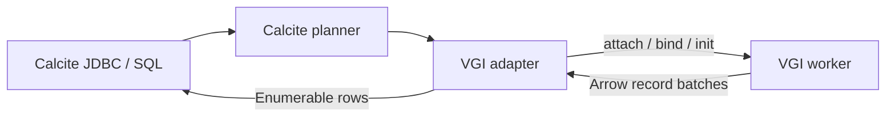

# Architecture and development

vgi-calcite connects Calcite's schema and execution interfaces to a VGI worker
through the VGI Java SDK. See the [README](../README.md) for a working demo and
the [usage guide](usage.md) for configuration and compatibility details.

## Query flow

| Component | Responsibility |
| --- | --- |
| [VgiSchemaFactory](../src/main/java/farm/query/vgicalcite/VgiSchemaFactory.java) and [VgiSchema](../src/main/java/farm/query/vgicalcite/VgiSchema.java) | Load a metadata snapshot and register worker tables, nested schemas, and table functions. |
| [VgiTable](../src/main/java/farm/query/vgicalcite/VgiTable.java) | Expose catalog tables through `ProjectableFilterableTable`, with supported column selection delegated to the worker. |
| [VgiTableMacro](../src/main/java/farm/query/vgicalcite/VgiTableMacro.java) and [VgiFunctionScan](../src/main/java/farm/query/vgicalcite/VgiFunctionScan.java) | Bind literal function arguments, discover the result schema, and retain each invocation in the prepared query. |
| [VgiSession](../src/main/java/farm/query/vgicalcite/VgiSession.java) and [VgiEnumerator](../src/main/java/farm/query/vgicalcite/VgiEnumerator.java) | Own each scan's connection and batches, convert rows, and clean up resources. |
| [ArrowTypes](../src/main/java/farm/query/vgicalcite/ArrowTypes.java) and [VgiTypeSystem](../src/main/java/farm/query/vgicalcite/VgiTypeSystem.java) | Map Arrow values to Calcite types and support decimal precision up to 38 digits. |

Schema objects hold metadata only. Each scan uses an independent connection;
there is no global connection registry or pool. Normal completion detaches.
Early close cancels the stream and closes its transport.

Rows own their Java values and remain valid after Arrow buffers are reused.
Data stays columnar during transport and becomes rows at Calcite's Enumerable
boundary.

Function arguments are part of the function operator's planner identity. This
keeps calls with different arguments distinct during optimization. A dedicated
operator preserves that identity through planning and execution.

Column selection is the only operation currently pushed down to the worker.
Calcite evaluates residual predicates and other relational operations. Using
Calcite's schema interfaces provides an integration point for applications that
combine VGI with other Calcite adapters.

## Dependencies

| Dependency | Version |
| --- | --- |
| Apache Calcite | 1.42.0 |
| VGI Java SDK | 0.48.0 |
| RPC SDK | 0.33.2 |
| Apache Arrow | 19.0.0 |
| Jackson BOM | 2.21.0 |
| SLF4J API | 2.0.17 |

Jackson is aligned with the VGI SDK's BOM. Mixing Calcite's Jackson 2.18 core
with the SDK's 2.21 CBOR codec causes HTTP stream-state decoding failures.
The adapter does not bundle a logging backend; embedding applications can
supply one.

## Verification

Run `./mvnw verify`. The suite executes real Calcite JDBC queries against a Java
VGI worker in a separate process, using the released SDK. It requires no
external service or sibling repository and does not silently skip a missing
worker.

Tests cover HTTP, TCP, Unix sockets, and stdio subprocesses; metadata mounting;
nested schemas; empty and multiple batches; projection fallback; SQL
operations; NULL and default arguments; multiple scan branches; distinct
function calls; repeated prepared statements; worker errors; and early
`LIMIT`. Type tests cover unsigned boundaries, temporal precision, numeric
carriers, and dictionaries.

The initial implementation passed all 24 tests with no skips on macOS ARM64
with both JDK 21 and JDK 27. A separate packaged-JAR check of
`COUNT(*), SUM(id)` over `sequence(17)` returned `17, 136`.
[GitHub Actions](https://github.com/Query-farm/vgi-calcite/actions/workflows/ci.yml)
runs the suite on Linux and macOS with JDK 21.

## Planned extensions

These are proposed next steps, not features of the current adapter:

1. Translate Calcite predicates into VGI v3 filters, negotiate semantic
   profiles, and preserve residual predicates. This would enable required-filter
   tables and reduce data transfer.
2. Add planner rules for broader relational pushdown, distributed split
   planning, and cancellation deadlines.
3. Design batched scalar and table-in/out operators that preserve VGI's
   vectorized execution model.
4. Add bounded connection reuse and metadata/version refresh with explicit
   lifecycle ownership, then benchmark against another Calcite adapter.

## References

- [Calcite adapter interfaces](https://calcite.apache.org/docs/adapter.html)
- [Calcite release history](https://calcite.apache.org/docs/history.html)
- [VGI Java SDK](https://github.com/Query-farm/vgi-java)
